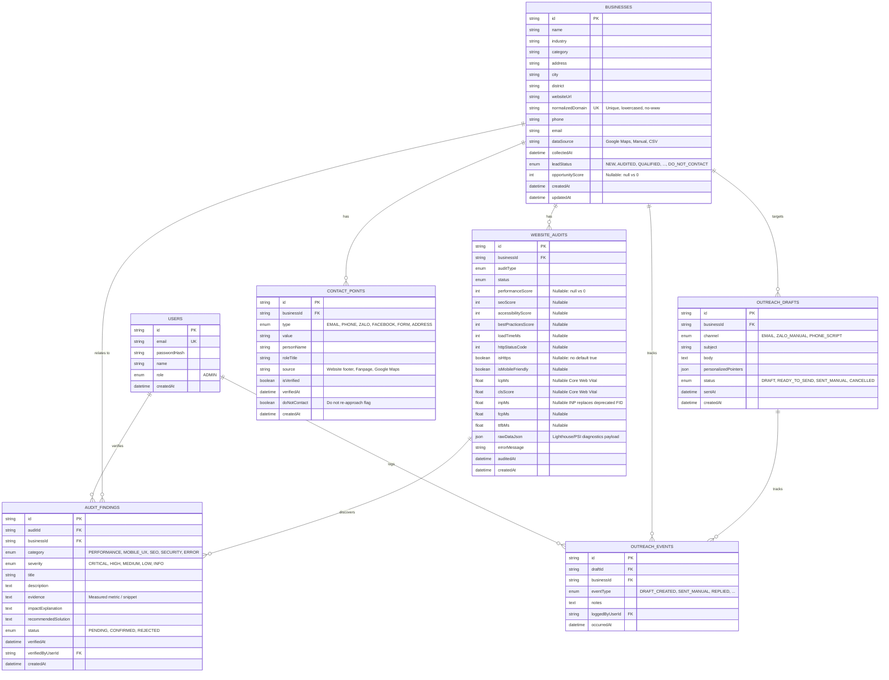

# LeadLift — System Architecture & Database Design Document

## 1. Project Overview

**LeadLift** is a Website Lead Discovery & Outreach System designed for freelancers and digital agencies to identify local businesses (hotels, motorbike rentals, restaurants, local services in Da Nang) that have existing websites with measurable technical and UX improvement opportunities, and generate personalized, fact-based outreach drafts.

---

## 2. Technology Stack (CP01A Foundation)

* **Framework:** Next.js 16.4.3 (App Router, Turbopack default)
* **Runtime:** Node.js v24.15.0
* **Language:** TypeScript 5.9.3 (Strict Mode enabled)
* **Styling Foundation:** Tailwind CSS v4
* **ORM:** Prisma ORM 7.10.1 (Configured via `prisma7.config.ts`)
* **Database:** Neon PostgreSQL (Serverless Cloud) with `@prisma/adapter-neon`
* **Package Manager:** npm 11.14.1
* **Version Control:** Git (branch: `feature/project-foundation-database`)

---

## 3. Database Architecture (7 Core Entities)

---

## 4. Security & Safety Strategy

### 4.1. SSRF Prevention Strategy
Any outbound HTTP audit must adhere to the following rules:
1. **Protocol & Port Whitelist:** Only `http:` and `https:`. Only ports `80` and `443`.
2. **DNS Pre-resolution & IP Blacklist:** Resolve DNS hostnames before socket connection. Disallow:
   - Loopback: `127.0.0.0/8`, `::1`
   - RFC 1918 Private ranges: `10.0.0.0/8`, `172.16.0.0/12`, `192.168.0.0/16`
   - Link-local & Cloud Metadata: `169.254.0.0/16`, specifically `169.254.169.254`
   - Unspecified: `0.0.0.0/8`
3. **Redirect Verification:** Manual redirects (`redirect: 'manual'`). If a `3xx` redirect is encountered, the new `Location` URL must pass the full DNS and IP validation again. Max 3 redirects.
4. **Limits:** Maximum 10-second timeout via `AbortController`, maximum 4MB payload.

### 4.2. Secrets & Credential Management
- Database credentials and Google API Keys must remain exclusively in `.env` (server-side runtime).
- Never expose sensitive tokens in `NEXT_PUBLIC_*` environment variables.
- Git ignores `.env`, `.env*.local`, and all private keys; only `.env.example` is tracked.

### 4.3. Rate Limiting & Ethical Auditing
- Minimum 15-second delay between audits of the same domain.
- Transparent `User-Agent` disclosing audit identity.
- Single on-demand audit trigger from admin interface to prevent server saturation.

### 4.4. Human-in-the-Loop & Privacy (Decree 13/2023/ND-CP)
- No automated bulk dispatch of emails or messages.
- Drafts require human review and manual sending.
- Respect `doNotContact` flags on contact points and `DO_NOT_CONTACT` lead status.

---

## 5. Neon Database Connection Setup

Prisma 7 uses two distinct connection strings:
1. **`DATABASE_URL` (Pooled):** Contains `-pooler` in hostname. Used by the application runtime for fast, pooled queries in serverless environments.
2. **`DATABASE_URL_UNPOOLED` (Direct):** Direct connection without `-pooler`. Used by Prisma CLI for schema migrations (`prisma migrate dev`).
